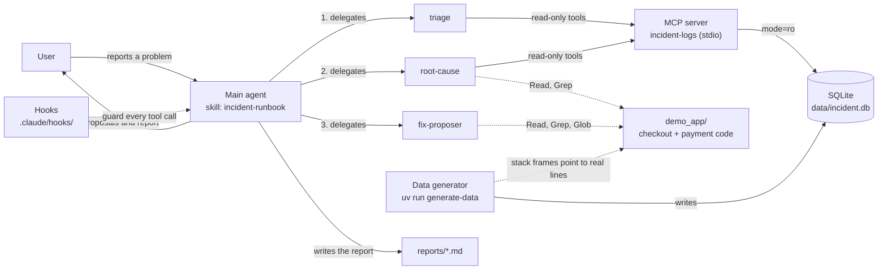
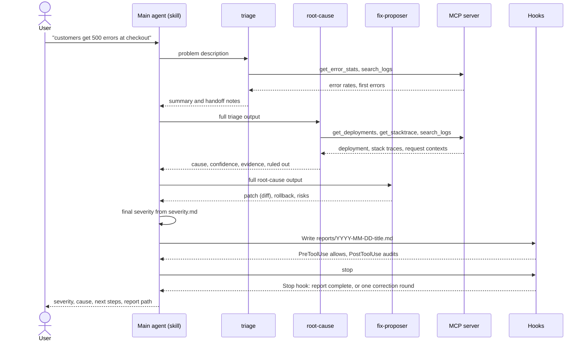
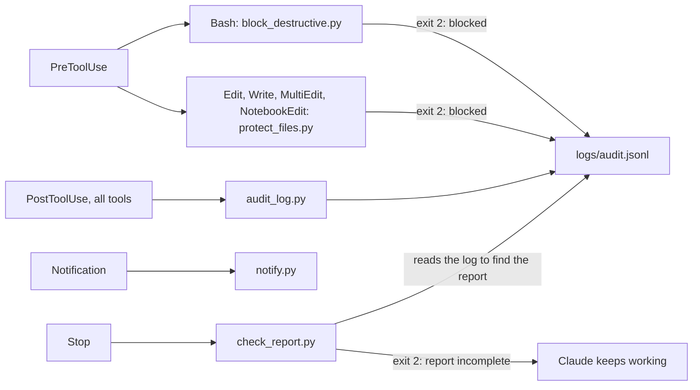

# Architecture

`incident-agent` is a Claude Code project, not a service. The "program" is the main Claude agent following a skill,
delegating to three subagents that read sample logs through an MCP server, with hooks guarding every tool call.
Why it is built this way: [adr/](adr/README.md).

## Components

## One investigation

Every tool call in this flow, including those of subagents, passes through the hooks.

## Hooks

## Building blocks

| Block | Role | Lives in |
|---|---|---|
| Main agent and skill | Orchestrates. The skill is the single source of the procedure, the severity matrix and the report template. Subagents cannot call each other, so the main agent passes each full output to the next | [`.claude/skills/incident-runbook/`](../.claude/skills/incident-runbook/SKILL.md), [CLAUDE.md](../CLAUDE.md) |
| `triage` | What is broken, since when, how bad. Only `get_error_stats` and `search_logs` | [`.claude/agents/triage.md`](../.claude/agents/triage.md) |
| `root-cause` | Cross-checks deployments, stack traces and request contexts. All four MCP tools plus `Read`, `Grep` | [`.claude/agents/root-cause.md`](../.claude/agents/root-cause.md) |
| `fix-proposer` | Patch, rollback, risks. Only `Read`, `Grep`, `Glob`: no MCP tools, no write access | [`.claude/agents/fix-proposer.md`](../.claude/agents/fix-proposer.md) |
| MCP server | Thin FastMCP layer over `queries.py`; four read-only tools, max. 200 rows per call, stdio (never prints to stdout) | [`src/incident_agent/mcp_server.py`](../src/incident_agent/mcp_server.py), [`.mcp.json`](../.mcp.json) |
| Query logic | Plain functions on a `sqlite3.Connection`, parameterized SQL, input validation, read-only connection (`mode=ro`) | [`src/incident_agent/queries.py`](../src/incident_agent/queries.py) |
| Database | One day (2026-03-12 UTC) of logs, deployments and errors of `checkout`, `payment`, `catalog`, `auth` | `data/incident.db` (generated, gitignored) |
| Data generator | Deterministic (fixed date, seeded RNG) normal traffic plus a scenario; `checkout-500`, `db-pool`, `cert-expired`, `api-outage` and `memory-leak` | [`src/incident_agent/data/`](../src/incident_agent/data/), [scenarios](scenarios.md) |
| Demo app | Stdlib-only code with the intentional bug of payment v1.4.2; its lines are what the generated stack traces point to | [`demo_app/`](../demo_app/), [demo-app.md](demo-app.md) |
| Hooks | Deterministic rules around the model: two guards, an audit log, a notification and a report check | [`.claude/hooks/`](../.claude/hooks/), [hooks.md](hooks.md) |

## Data flow

1. `uv run generate-data` writes `data/incident.db` (the only writer; the MCP server never writes).
2. Claude Code starts the MCP server from `.mcp.json` (`uv run incident-logs-server`). It opens the database
   read-only for every query, from `data/incident.db` or the path in `INCIDENT_DB_PATH`.
3. `triage` and `root-cause` query it. Raw log output stays in their own context; only summaries return to the main
   agent.
4. `root-cause` and `fix-proposer` read `demo_app/` to confirm the failing line. For `db-pool` there is no catalog
   code in the repo (synthetic frames), and the agents say so.
5. The main agent writes `reports/YYYY-MM-DD-short-title.md` (gitignored). Fixes stay proposals in the report.

## Trust boundaries

| Boundary | What enforces it |
|---|---|
| Log data is read-only for the agent | SQLite `mode=ro` plus `PRAGMA query_only`, parameterized SQL, no write tool in the MCP server |
| Subagents cannot change anything | Explicit `tools` allowlists without `Write`, `Edit`, `Bash`, `NotebookEdit`; checked by `tests/test_agents.py` |
| Destructive shell commands | `block_destructive.py` (PreToolUse, Bash): pattern rules, fail closed |
| Secrets, databases, `data/`, CI workflows | `protect_files.py` (PreToolUse, file tools): fail closed. Does not cover shell writes |
| Trail of what happened | `audit_log.py` (PostToolUse): every call and every blocked attempt, fail open |
| Complete report | `check_report.py` (Stop): one correction round, fail open |
| The human decides | Nothing in the repo applies a fix; the demo bug is never fixed on `main` |

The hooks are a safety net against mistakes, not a security boundary: they are pattern based and can be bypassed
(see [hooks.md](hooks.md#limitations)). The notification hook can send text to Slack if `SLACK_WEBHOOK_URL` is set, so
that variable is a secret.
